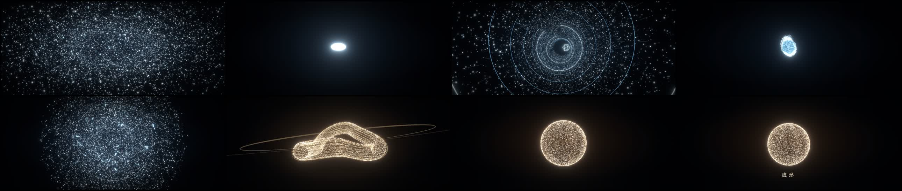

# Claude 视频实验室

这是一个本地的 AI 程序化视频工程。Claude Code 或 Codex 负责按你的描述修改 React/TypeScript，Remotion 负责预览、逐帧渲染和导出 MP4。

首次接手请先读 [项目指引](PROJECT_GUIDE.md) 和 [制作过程复盘](docs/制作过程复盘.md)；Agent 从 [AGENTS.md](AGENTS.md) 开始。分享包带有预生成音频，V2 无须 API Key。

[下载样片和交接压缩包](https://github.com/lyf2474979624-ai/claude-video-lab/releases/tag/handoff-2026-10-02)

```bash
git clone https://github.com/lyf2474979624-ai/claude-video-lab.git
cd claude-video-lab
npm ci
npm run dev
```



> 关键认知：Claude 在这套工作流里不是直接“画出每一帧”的视频模型，而是视频导演 + 程序员。这对字幕、动效、产品演示、数据视觉化和批量模板特别合适；要生成写实画面，还需再接视频/图像生成模型。

## 已经准备好的东西

- 当前版本《成形》：28 秒、60fps、Three.js 粒子形变、空间穿行、破碎重组与同步立体声音效；无旁白和说明字幕
- Remotion 4 + React 19 + TypeScript
- Remotion 官方 Agent Skills（项目内安装，Claude Code/Codex 均可读取）
- 12 秒、1920×1080、30fps 的三场景中文样片
- 5 张 2.39:1 电影宽画幅风格帧，作为新版动画的视觉基准
- 旧版 33 秒流程样片：静态画面推拉配旁白，保留作对照；未达到用户要求的运动效果
- 独立场景预览，便于逐段修改
- 素材、成片、文档和提示词的固定目录

## 立即开始

```bash
cd claude-video-lab
npm ci
npm run dev
```

浏览器会打开 Remotion Studio。在左侧选择 `BecomingFilmV2` 查看当前版本；`SignalFormFilm` 是旧版，`Styleframes` 是之前的静态探索。

重新渲染五张风格帧及总览图：

```bash
npm run render:styleframes
```

从音频生成到完整 MP4 一键导出：

```bash
npm run render:film
```

当前输出为 `out/becoming-v2.mp4`。动作与声音时间点共用 `src/film-v2/timing.json`，不调用 TTS。
命令结束时会生成 `out/becoming-v2.motion-check.json`，检查实际帧数、逐秒帧差及音轨。
帧差只能说明画面存在运动，不能证明审美质量。

设计逻辑见 [docs/风格帧方向.md](docs/%E9%A3%8E%E6%A0%BC%E5%B8%A7%E6%96%B9%E5%90%91.md)。
已验证与待尝试的环节见 [docs/流程状态.md](docs/%E6%B5%81%E7%A8%8B%E7%8A%B6%E6%80%81.md)。

导出 MP4：

```bash
npm run render
```

成片会出现在 `out/claude-video-demo.mp4`。

## 怎么和 Claude Code / Codex 一起做

在项目目录中启动你想用的 Agent：

```bash
claude
# 或
codex
```

然后直接描述，例如：

> 把现在的样片改成 20 秒的竖屏小红书视频，主题是“AI 为什么把视频变成了代码”。前 2 秒要有强钩子，每 3–4 秒更换一次视觉重心，字号适合手机阅读。先修改预览，不要导出。

更稳定的提示词框架见 [prompts/视频需求模板.md](prompts/%E8%A7%86%E9%A2%91%E9%9C%80%E6%B1%82%E6%A8%A1%E6%9D%BF.md)。

## 目录

```text
src/                 Remotion 视频代码
src/scenes/          可独立预览的场景
public/assets/       图片、视频、音频、字体
prompts/             视频需求和 Agent 提示词
docs/                调研与工具选型
out/                 渲染成片（Git 默认忽略）
.agents/skills/      Remotion 官方 Agent Skills
```

## 常用命令

| 命令 | 作用 |
| --- | --- |
| `npm run dev` | 打开可交互预览 |
| `npm run lint` | 检查 TypeScript 和 ESLint |
| `npm run build` | 构建 Remotion bundle |
| `npm run render` | 导出默认 MP4 |
| `npm run render:film` | 导出当前 3D 运动与音效版本，并检查帧变化 |
| `npm run render:film-v1` | 重新导出旧版旁白样片，仅供对照 |
| `npm run render:styleframes` | 导出五张风格帧和总览图 |
| `npm run upgrade` | 升级 Remotion |

## 适合与不适合

适合：短视频动效、产品宣传、终端/网页演示、数据排行、字幕视频、课程视觉、批量品牌模板。

不擅长：只给一句提示词就生成写实人物、复杂镜头运动或电影级镜头。这类画面应用专门的视频模型生成素材，再放入 Remotion 编排。

## 许可提醒

Remotion 对个人、非营利机构和最多 3 人的营利团队提供免费许可；更大的营利组织需要查看官方公司许可条款。
